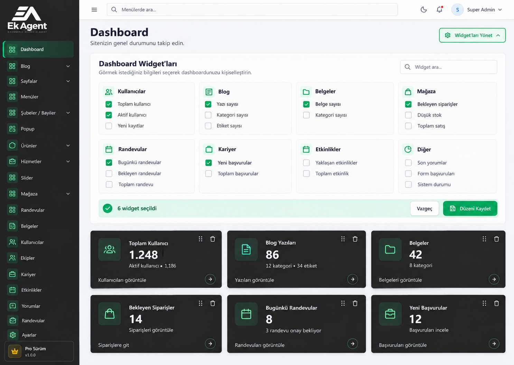

# Faz 2 — Modüler Dashboard Widget Sistemi

## Amaç ve kapsam

Aktif modüllerin sunduğu widget'ları ortak dashboard üzerinde keşfetmek; yöneticinin kendi yetkileri kapsamında widget seçmesini, önizlemesini, sıralamasını ve düzenini kaydetmesini sağlamak. Her modül kendi widget tanımlarını ve veri hesaplamasını taşır. Ana uygulama ortak kayıt, yetkilendirme, tercih yönetimi ve kart görünümünden sorumludur.

Bu belge uygulama planıdır. Aşağıdaki sınıflar, metadata alanları ve tablo önerilen yeni yapılardır; mevcut özellikler gibi değerlendirilmemelidir. Faz 1 analitik kapsamı ayrı kalır; widget altyapısı ileride çekirdek analitik kartlarının kaydını da destekleyebilir.

## Referans tasarım



Görsel, yerleşim ve etkileşim referansıdır. Görselde tekrarlanan menüler, temsilî sayılar ve mevcut sistemde karşılığı olmayan seçenekler uygulamaya otomatik taşınmaz. Gerçek sidebar, modül listesi ve izinler kullanılır.

### Görsel kurallar

| Öğe | Kural |
|---|---|
| Sidebar ve widget kartı | `#262626` |
| Widget ikonu | `#58d99a` |
| İkon kutusu | `#19a96b29` |
| Ana içerik | Mevcut Tabler düzeniyle uyumlu açık nötr zemin |
| Widget yönetim paneli | Beyaz zemin, ince kenarlık, hafif gölge |
| Tipografi | Beyaza yakın kart başlıkları ve sayılar, okunaklı gri alt metin |
| Yerleşim | Masaüstünde 3, tablette 2, mobilde 1 kart sütunu |
| Kontroller | Mevcut Tabler bileşenleri ve çizgi ikonları |

Başlık `Dashboard`, açıklama `Sitenizin genel durumunu takip edin.` olur. Sağdaki `Widget'ları Yönet` düğmesi başlığın altında seçim panelini açar. Panelde arama alanı, modül grupları, checkbox seçenekleri, seçilen widget sayısı, `Vazgeç` ve `Düzeni Kaydet` bulunur. Kartlar tutarlı yükseklik, başlık, sayı, açıklama ve varsa ilgili ekrana bağlantı içerir. Sürükleme ve kaldırma kontrolleri düzenleme açıkken görünür.

## 1. Uygulama öncesi keşif

- [ ] `.ai/rules/index.md` üzerinden ilgili mimari, modül, admin arayüzü ve yetkilendirme kurallarını yeniden kontrol et.
- [ ] Uygulama değişikliklerinden önce ilgili domain skill'lerini oku. Görseli arayüze dönüştürürken ilgili tasarım skill'ini etkinleştir.
- [ ] Paket API'si kullanmadan önce `composer show --direct` ve `package.json` ile sürümleri doğrula; Laravel ekosistemine bağlı değişiklikler için Boost `search-docs` kullan. Boost yoksa kullanılabilir resmî belgelerle ilerle.
- [ ] Mevcut `ModulePanelService`, admin guard, modül etkinlik denetimi, dashboard route'u, ikon bileşeni ve panel JS girişini incele.
- [ ] Kullanıcıya ait mevcut değişiklikleri koru. Yeni bağımlılık gerektiren bir seçimde önce proje bağımlılık kuralını uygula.

## 2. Modül widget sözleşmesini oluştur

Örnek modül yapısı:

```text
Modules/Blog/
├── config/
│   └── widgets.php
├── app/
│   └── Dashboard/
│       └── Widgets/
│           ├── BlogCountWidget.php
│           ├── CategoryCountWidget.php
│           └── TagCountWidget.php
└── module.json
```

- [ ] `DashboardWidget` ortak sözleşmesini tanımla. Bu sözleşme bağımsız modüller ile çekirdek dashboard arasındaki gerçek entegrasyon sınırıdır.
- [ ] Her widget için kalıcı kimlik, başlık, ikon, gerekli görüntüleme izinleri, varsayılan görünürlük, varsayılan sıra ve kart türünü tanımla.
- [ ] Veri sonucunu sayı/değer, isteğe bağlı açıklama ve işlem bağlantısı içeren tipli bir veri nesnesiyle veya PHPDoc array shape ile sınırla.
- [ ] İlk sürümde yalnız istatistik kartı sun. Kayıt listesi ve grafik türlerini ihtiyaç çıktığında ekle.
- [ ] Widget sınıfları veri sorgularını kendi modülünün sınırında yürütür; ana dashboard modül modellerini doğrudan çağırmaz.
- [ ] Bağlantıları mevcut named route'larla üret. Kimliklerde modül alias'ını önek kullan: `blog.posts.count`, `blog.categories.count`, `users.total`, `appointments.today`.
- [ ] Kimliği başlıktan türetme. Başlık değişince kayıtlı seçim korunmalı; kimlik değişikliği gerekiyorsa tercih geçişini ayrıca planla.

Önerilen `module.json` eklemesi, diğer `panel` alanları korunarak yapılır:

```json
{
  "panel": {
    "widgets": "config/widgets.php"
  }
}
```

`widgets.php`, modüle ait widget sınıflarının listesini döndürür. Widget başlıkları ve diğer metadata sınıfta tutulur; kayıt dosyasında tekrar edilmez.

## 3. Ortak widget kaydını kur

| Önerilen bileşen | Sorumluluk |
|---|---|
| `DashboardWidgetRegistry` | Etkin modüllerin tanımlarını keşfetmek ve kayıtları doğrulamak |
| `DashboardService` | Yetkiye açık widget'ları ve seçilmiş widget verilerini hazırlamak |
| `DashboardPreferenceService` | Yöneticiye özel seçim, sıra ve kayıt çakışmasını yönetmek |
| `DashboardController` | Dashboard gösterimi, veri ve tercih işlemlerini yönlendirmek |
| Ortak Blade kart bileşeni | Bütün modüllerde tutarlı görünüm sağlamak |

- [ ] Sınıfları uygulamanın mevcut `app/Services/Admin`, controller ve view yapısına uygun yerleştir; gereksiz repository veya provider katmanı ekleme.
- [ ] Menü keşfindeki yaklaşımı izleyerek yalnız kurulu ve etkin modülleri tara.
- [ ] Metadata'daki dosya yolunu modül içinde tut; modül dışına çıkan yolları reddet.
- [ ] Kayıtların sınıfını, sözleşmeye uygunluğunu ve kimlik benzersizliğini doğrula. Tekrarlanan kimlikte sessizce üzerine yazma.
- [ ] Ana uygulamada modül isimleri listesi, modül başına import veya switch yazma.
- [ ] Widget metadata'sını toplarken sayı sorgularını çalıştırma.
- [ ] Bozuk bir modül kaydını logla ve diğer modüllerin dashboard'unu çalışır tut.
- [ ] Faz 1 gibi çekirdek özellikler için gerekiyorsa aynı sözleşmeyi kullanan ayrı çekirdek kayıt kaynağı ekle; bunları yapay bir Nwidart modülüne dönüştürme.

## 4. Yetkilendirmeyi uygula

- [ ] Bütün dashboard endpoint'lerinde `auth:admin` ve aktif yönetici denetimini uygula.
- [ ] Widget görünürlüğünü modül etkinliği ve ilgili veri görüntüleme izniyle belirle. Süper admin de etkinlik denetimini geçemez.
- [ ] Seçim listesi, veri yükleme, önizleme ve kaydetme aşamalarında sunucu tarafında yetkiyi yeniden kontrol et.
- [ ] Menü görünürlüğü ile veri erişimini ayır; widget için ilgili `*.view` iznini kullan. `*.menu` iznini veri erişiminin yerine kullanma.
- [ ] Alt metrikleri ve işlem bağlantılarını ayrıca yetkilendir. Örneğin yalnız `blog.view` izni olan kişiye kategori ve etiket sayısını koşulsuz gösterme.
- [ ] İstemciden sınıf adı, sorgu, model, view yolu veya başka yöneticinin kimliğini kabul etme. Yalnız kayıtlı widget kimlikleriyle çalış.

## 5. Yönetici tercihlerini sakla

Önerilen tablo: `admin_dashboard_preferences`. Şema uygulama sırasında mevcut veritabanı ve model yapısı incelenerek kesinleştirilir.

| Alan | Amaç |
|---|---|
| `id` | Birincil anahtar |
| `admin_id` | `admins` ilişkisi, yönetici başına tek kayıt |
| `widget_order` | Seçilen widget kimliklerinin sıralı JSON listesi |
| `revision` | Eşzamanlı düzenleme sürümü |
| `created_at`, `updated_at` | Kayıt tarihleri |

```json
{
  "widget_order": ["users.total", "blog.posts.count", "appointments.today"],
  "revision": 3
}
```

- [ ] Tercih kaydı olmayan yöneticiye yalnız erişebildiği varsayılan widget'ları göster.
- [ ] Kaydedilmiş boş listeyi bilinçli boş dashboard olarak kabul et; varsayılanlarla doldurma.
- [ ] Yönetici kimliğini oturumdan al; tercihi web kullanıcısına veya genel site Settings değerlerine yazma.
- [ ] Sayısal widget verilerini tercihe kaydetme.
- [ ] Modül kapatıldığında veya izin kaldırıldığında widget'ı gizle; kayıtlı kimliğini koru.
- [ ] Kaydetmede sunucudaki erişilemeyen eski kimlikleri koruyup erişilebilir seçimi ve sırasını güncelle. Korunan kimlikler veri yükleme yetkisi sağlamaz.
- [ ] Modül yeniden açıldığında korunmuş seçimi geri göster. Yeni kurulan modülün widget'larını mevcut kişisel düzene otomatik ekleme; seçim panelinde sun.
- [ ] Seçim kaydını atomik yap; beklenen `revision` eşleşmiyorsa çakışma yanıtı ver. Aynı anda ilk kayıt oluşturma durumunu da yönet.
- [ ] Tekrarlanan kimlikleri, bozuk payload'u ve yeni eklenmeye çalışılan bilinmeyen/yetkisiz widget'ları reddet.

## 6. Endpoint ve veri yükleme akışını kur

Önerilen named route'lar:

| Route adı | Görev |
|---|---|
| `admin.dashboard` | Sayfa, erişilebilir tanımlar ve kayıtlı düzen |
| `admin.dashboard.widgets.data` | Seçilen widget'ların toplu verisi |
| `admin.dashboard.preferences.update` | Kişisel seçimi ve sıralamayı kaydetmek |

- [ ] Mevcut dashboard route adını ve adresini koruyarak view route'unu controller'a yönlendir.
- [ ] Sayfa açılışında yalnız seçilen widget verilerini yükle; önizleme sırasında yeni seçilen kartın verisini iste.
- [ ] CSRF, istek boyutu sınırı, benzersiz kimlik ve revision doğrulamasını uygula. Arayüzde gösterilen widget sayısından bağımsız güvenli bir istek sınırı belirle.
- [ ] Her istek için etkinlik ve erişim denetimini tekrar yap; kapalı modül sınıfını veya verisini çalıştırma.
- [ ] Tek widget hatasını diğer kartlardan yalıt. Hatalı kartta `Veri yüklenemedi` ve yeniden deneme göster; başarısız sorguyu `0` gibi sunma.
- [ ] Tarihe bağlı metriklerde uygulamanın saat dilimini ve gün sınırlarını kullan.
- [ ] İlk sürümde otomatik polling ekleme. Cache gerekiyorsa veri kapsamını ve yetki sınırını koruyarak ölçülen ihtiyaca göre uygula.

## 7. Tasarımı ve düzenleme davranışını uygula

- [ ] Ortak Blade kartını ve widget yönetim panelini mevcut Tabler layout içinde oluştur.
- [ ] Ortak dashboard JS davranışını mevcut `resources/js/panel.js` girişinden başlat. Modüle özel JS gerekiyorsa mevcut `panel.assets` sözleşmesini kullan.
- [ ] Paneli yalnız aktif ve yetkiye açık widget'larla modüllere göre grupla; Türkçe arama ve seçili widget sayısını ekle.
- [ ] `Widget'ları Yönet` panel açma düğmesine erişilebilir açık/kapalı durumunu ekle.
- [ ] Checkbox, kart kaldırma ve sıralama işlemlerini aynı geçici düzen üzerinde çalıştır.
- [ ] Değişiklikleri kaydetmeden önizle; `Vazgeç` ile son kayıtlı seçime ve sıraya dön.
- [ ] `Düzeni Kaydet` sırasında yinelenen gönderimi engelle. Başarıdan sonra kayıtlı durumu güncelle; hatada geçici düzeni koru ve mevcut bildirim altyapısını kullan.
- [ ] Sürükleme yanında klavyeyle kullanılabilen öne/arkaya taşıma kontrolleri ekle; ikonlu işlemlere erişilebilir etiket ver.
- [ ] Boş dashboard, erişilebilir widget olmaması, yüklenme, hata ve kayıt çakışması durumlarını tasarla.
- [ ] Eski veri isteği geç tamamlandığında kaldırılmış bir widget'ı tekrar eklememesini sağla.

## 8. Mevcut modülleri sırayla bağla

Önce Kullanıcılar ve Blog ile uçtan uca örnek tamamlanır. Ardından aşağıdaki mevcut veri kaynakları bağlanır. Metriklerin gerçek durum değerleri ve ilgili route/izinleri koddan doğrulanır.

| Sıra | Modül | İlk widget'lar |
|---|---|---|
| 1 | Users | Toplam kullanıcı, aktif kullanıcı |
| 2 | Blog | Yazı sayısı, kategori sayısı, etiket sayısı |
| 3 | Documents | Belge sayısı, kategori sayısı |
| 4 | Appointments | Bugünkü randevular, bekleyen randevular |
| 5 | Careers | Yeni başvurular, aktif iş ilanları |
| 6 | Store | Bekleyen siparişler, düşük stok |
| 7 | Events | Yaklaşan etkinlikler, kayıt sayısı |
| 8 | Diğer içerik modülleri | İlgili kayıt, aktif kayıt ve varsa kategori sayıları |

- [ ] Belgeler için mevcut olmayan etiket ilişkisi üretme.
- [ ] Stok widget'ında varyantları, stok takibini, arşivli ürünleri ve eşik kurallarını mevcut Store servisleriyle tutarlı hesapla.
- [ ] Ödeme durumunu sipariş durumundan ayır; satış toplamı istenirse ödeme/iade ve para birimi kapsamını ayrıca tanımla.
- [ ] Görseldeki örnek sayıları sabit veri olarak uygulamaya koyma.

## 9. Yeni modül oluşturma kuralını kalıcılaştır

Faz 2 kapsamında modül oluşturma kurallarına şu zorunluluk eklenmelidir:

> Her yeni modül, kendi iş alanını özetleyen en az bir dashboard widget'ı sağlamalıdır. Widget tanımları modülün `config/widgets.php` dosyasında kaydedilmeli, veri hesaplaması modülün `app/Dashboard/Widgets` dizinindeki sınıflarda tutulmalı ve kayıt kaynağı `module.json.panel.widgets` ile belirtilmelidir. Widget ortak sözleşmeye uymalı, kalıcı ve benzersiz bir kimlik taşımalı, modül etkinliğini ve gerekli veri görüntüleme izinlerini gözetmeli, ortak kart bileşenini kullanmalı ve yeni modül kurulduğunda ana dashboard kodu değiştirilmeden keşfedilmelidir. Modülün tamamlanma kontrolü widget kaydı ve anlamlı test kapsamını da içermelidir.

- [ ] Bu kuralı uygulama sırasında `.ai/rules/moduller.md` dosyasına ekle ve bu planla bağlantılandır.
- [ ] `.ai/workflows/modul-gelistirme.md` kontrol listesine widget oluşturma, kayıt ve yetki kontrollerini ekle.
- [ ] Mevcut `stubs/modules` üretim akışını incele; uygun şablon ve üretim adımlarını bu sözleşmeye göre güncelle.
- [ ] En az bir anlamlı toplam/durum metriği seç. Konum gibi referans modüllerinde kayıt veya veri aktarım özeti kullanılabilir; varsayılan görünürlük kapalı olabilir.
- [ ] Gerekli izinleri modülün kendi `panel.permissions` alanında tanımla; başka modülün izin listesini değiştirme.
- [ ] Ortak dashboard'a modül başına import, if/switch veya manuel merkezî liste eklemeyi yasakla.
- [ ] Ek alan tanımları olan `features.json` dosyasını widget kaydı için kullanma.
- [ ] Widget dosyalarını normal modül paket içeriğine dahil et. Kaynak staging işlemini mevcut kurallara göre yap; release ve yayın için ayrı açık talep şartını koru.

Bu bölümdeki maddeler henüz gerçekleştirilmiş kural dosyası değişiklikleri değildir; Faz 2 uygulamasının zorunlu adımlarıdır.

## 10. Doğrulama ve tamamlanma ölçütleri

- [ ] Test yazmadan önce `testing-best-practices` skill'ini oku.
- [ ] Ortak kayıt, benzersiz kimlik, kapalı/kaldırılmış modül ve bozuk widget durumlarını test et.
- [ ] Yetkisiz veri/alt metrik/bağlantı sızıntısı olmamasını doğrula.
- [ ] Yönetici tercihlerinin hesaplar arasında ayrıldığını, boş seçimin korunduğunu ve sıralamanın kaydedildiğini test et.
- [ ] Modül kapatma/açma ve izin kaybı/geri verilmesi sırasında kayıtlı seçimin korunmasını test et.
- [ ] Geçersiz kimlik, yinelenen seçim, eşzamanlı kayıt, ilk kayıt yarışı ve widget veri hatasını test et.
- [ ] Modüle özgü metrik testlerini ilgili modülün test dizininde tut; ortak davranışları uygulama testlerinde kapsa.
- [ ] Etkilenen dar test kümesini çalıştır. PHP değişmişse `vendor/bin/pint --dirty --format agent`, frontend değişmişse `npm run build` çalıştır.
- [ ] Masaüstü/mobil görünümü, klavye kullanımı, önizleme, vazgeçme ve kaydetme akışını doğrula.
- [ ] Yeni örnek modül widget'ının ana dashboard kodu değişmeden keşfedildiğini doğrula.
- [ ] Başarılı modül değişikliklerini mevcut farkları koruyarak `D:\localhost\ekAgentModules\<Modul>` kaynak staging alanına aktar.

Faz 2; kişisel düzen kalıcı olduğunda, yalnız erişilebilir aktif modüller gösterildiğinde, referans tasarım uygulandığında ve yeni modül/widget ekleme akışı kurallara ve üretim kontrol listesine işlendiğinde tamamlanır.
